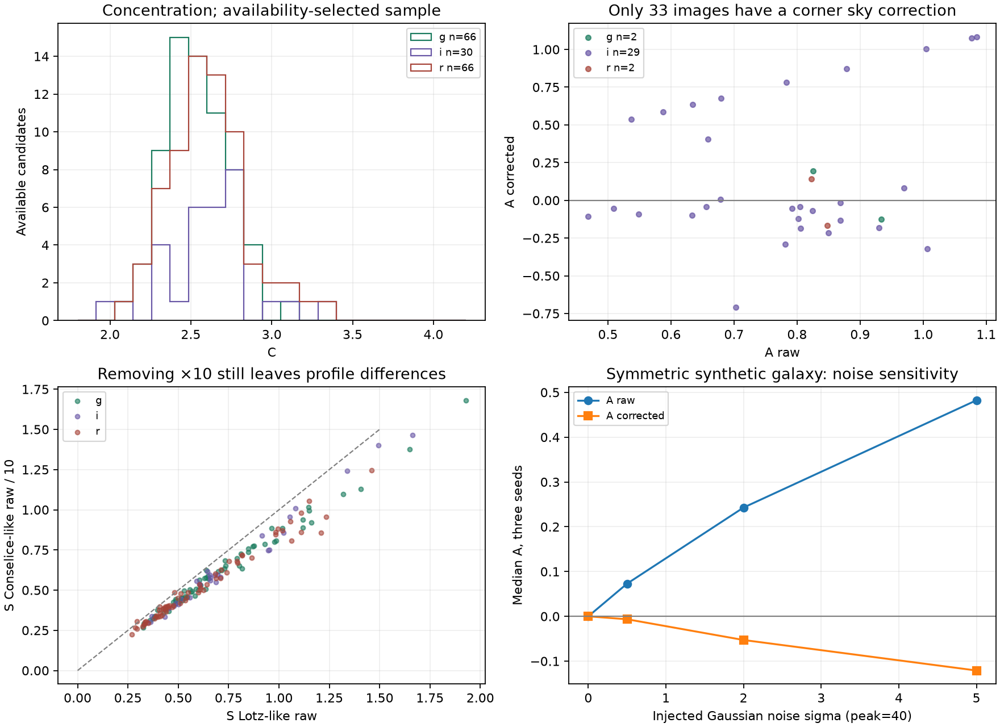
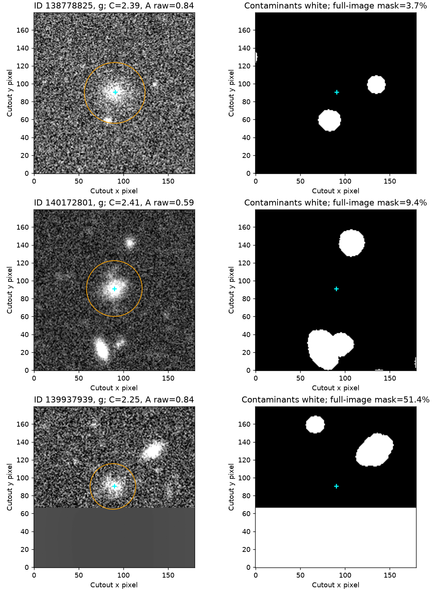

# DES CAS availability-selected pilot — 2026-10-20

Run `20261020T173805630133Z_b5f7d0d3`, method `cas_discrete_v2`; both original S profile names retained.
Table SHA-256: `11e4eeb76b92a11447281dad217098d0280d98c27db60c1d99b1471cc1e6fbc9`.

The sample is the union of 75 candidate IDs with precomputed products in the local
nucleated_lsbg legacy-fliplr object-centered 1024-pixel output tree. It is an
availability sample from the 84,200-row candidate catalog, not a representative
LSBG population or a confirmed-galaxy sample. No CAS-based selection was made.
All 225 requested object-band rows are retained, including 63 absent images.
Source files were read without modification or an additional image flip.

## Coverage

```
band  requested  available  C  A_raw  A_corrected  S_lotz_corrected  S_conselice_corrected
   g         75         66 66     66            2                 2                      2
   i         75         30 30     30           29                29                     29
   r         75         66 66     66            2                 2                      2
```

`ok` means finite C and raw A, not a guarantee of a usable sky correction or
scientific accuracy. The HTML report includes all variants, finite-only sample
quantiles, missing counts and flag frequencies. `statistics.csv` gives p16,
median and p84; these describe this selected sample, not measurement errors.

## Measured behavior



Median C is 2.538 (g), 2.588 (r) and 2.645 (i); median raw A is
0.775, 0.728 and 0.787 respectively. These large raw asymmetries cannot be
interpreted as intrinsic disturbance without noise calibration. Only 2/66 g,
2/66 r and 29/30 i images have valid sky corrections. In i, 17/29 corrected A
values are negative; the median is −0.044. The g/r corrected samples are too
small for distribution or correlation conclusions. Corrected subsets are not
representative of the available sample.

In the symmetric synthetic scene with zero PSF smoothing, median raw A rises
from 0 to 0.073, 0.243 and 0.482 as noise sigma rises from 0 to 0.5, 2 and 5.
The corresponding corrected medians are approximately 0, −0.007, −0.053 and
−0.121. This exposes negative bias under these controlled settings; sky
subtraction alone does not recover zero asymmetry at high noise. No DES error
bar or noise calibration is inferred from these three-seed experiments.

## Profile comparisons

```
band  comparison  matched  spearman  median_conselice_div10_minus_lotz
   g       S raw       66   0.99399                          -0.080245
   g S corrected        2         1                         -0.0098496
   i       S raw       30   0.96841                          -0.085533
   i S corrected       29   0.99704                          -0.011505
   r       S raw       66   0.98768                          -0.071442
   r S corrected        2         1                          -0.016519
```

The division by ten above removes only the Conselice normalization. Remaining
differences also reflect the kernel size and excluded central radius; they do
not establish which profile is better. Correlations use paired finite rows.
`band_comparisons.csv` likewise uses only common object IDs in each band pair;
independent g/r/i distributions have different sample membership.

Raw S rank correlations between profiles are 0.994 (g), 0.988 (r) and 0.968 (i).
After dividing Conselice S by ten, median paired differences remain −0.080,
−0.071 and −0.086 respectively, consistent with the profiles measuring different
residuals and regions. Rank agreement does not validate either definition.

## Input and quality checks



The sheet selects g-band objects at the minimum, median and maximum full-image
mask fractions. Cyan marks the catalog WCS center; orange marks the measured
CAS aperture. It is an illustrative visual inspection, not an exhaustive target
segmentation validation.


All 162 existing image-mask pairs have identical target WCS positions, target
positions within 0.5 pixel of the stamp geometric center, and an unmasked target
pixel. The runner also checks WCS agreement on a 3×3 grid across each stamp.
The masks contain 0/1/2 values in g/r (overlapping upstream mask contributions)
and 0/1 in i; all nonzero values are contaminants. WCS agreement establishes
alignment between stored arrays, not an independent astrometric calibration.
`mask_diagnostics.csv` records the mask fraction inside each measured aperture
and the most valid of the four corner tiles. Median aperture mask fractions are
2.6% (g), 7.2% (r) and 8.2% (i), with maxima 27.7%, 36.7% and 49.9%.
The median best-corner valid fraction is 93.85% in g/r, below the 95% criterion,
and 100% in i. This explains the band dependence in missing corrections without
requiring a claim about the galaxies' intrinsic structure. Better blank-region
selection should be evaluated as a separately versioned sky method.

The upstream legacy horizontal flip has not been reinterpreted or reapplied.
FITS DATE-OBS normalization warnings occurred; no data arrays were altered.

Flags: `{"no_clean_sky_tile": 129}`.
Errors: `{"missing_cutout": 63}`.

## Controlled sensitivity experiment

`sensitivity.csv` contains 144 deterministic synthetic measurements: symmetric
Gaussian and offset-clump scenes, PSF sigma 0/1/2 pixels, noise sigma 0/0.5/2/5,
three random seeds and an injected masked contaminant variant. The target
Gaussian has peak 40 and sigma 12 pixels; the offset clump has peak 12, sigma 2.
All metrics, including Petrosian radius and center, are remeasured in every case.
`sensitivity_summary.csv` gives medians across the three seeds. These are stress
experiments with known scenes, not a DES noise or PSF calibration. Three seeds
are insufficient for quantitative uncertainty estimates. A masked scene also
removes some genuine galaxy light under the contaminant footprint.

## Interpretation limits and next validation

The corner-only sky estimator often cannot find a ≥95% valid 32-pixel tile in
these masked fields. Missing corrections remain null. The corrected subset
therefore has additional selection bias. Negative corrected values are retained.
The cleanest-corner choice, integer-aligned sky rotation versus subpixel galaxy
rotation, noise, PSF, target-mask extent and discrete apertures may bias values.
No morphology classes or published CAS thresholds are assigned. Both A outputs
and both S profiles remain necessary for subsequent calibration.

Matched statmorph/historical implementation agreement and DES-specific injection
recovery, PSF matching and uncertainty calibration remain unperformed. These are
required before physical classification or population conclusions. The present
report establishes end-to-end execution and exposes limitations of this pilot.

## Reproduction

Install this repository and its declared test dependencies, then run:

```bash
python scripts/prepare_des_pilot.py --output .outputs/des_inputs_new
python -m algorithmic_morphology run --config-file-name .outputs/des_inputs_new/config.py --chunk-size 15
python scripts/validate_sensitivity.py --output .outputs/sensitivity_new
python scripts/analyze_pilot.py --run-dir <completed-run-directory> --inputs .outputs/des_inputs_new --sensitivity .outputs/sensitivity_new --output <new-report-directory>
```

The preparation script accepts `--source-project` and `--catalog` for other local
locations. The exported config records the actual local paths. Run manifests
record package versions, code hashes, catalog/config fingerprints and numerical
settings; table rows contain image/mask SHA-256. The run began with uncommitted
fixes, so code hashes, rather than its base git commit alone, identify the code.


The `run_source/` directory preserves all five package source files exactly as
used in the real run, verified against the manifest hashes. Subsequent runner
hardening makes git metadata optional and fsyncs the latest-symlink directory;
neither changes numerical measurements. `manifest.json` references checkpoint
parts in the original local run directory; the portable export contains the
canonical table rather than duplicating those partitions. Plot regeneration:

```bash
python scripts/plot_pilot.py --report-dir reports/des_pilot_20261020
```
